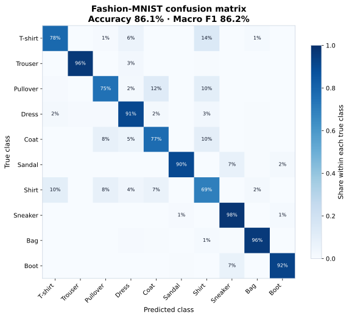
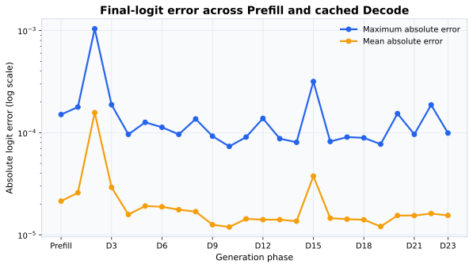
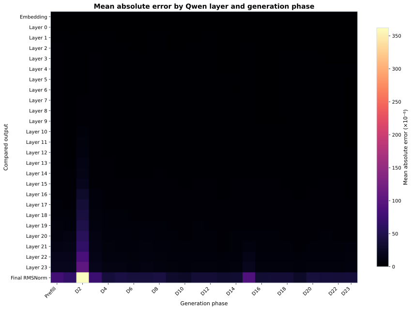
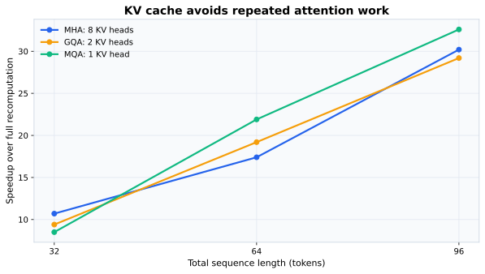

# tinyinfer

A lightweight C++20 CPU inference runtime for graph and generative workloads.

## Capabilities

| Area | Implemented |
|---|---|
| Tensor | Shared CPU buffers, typed storage, strided views, zero-copy reshape, FP32 activations and BF16 weights |
| CPU ops | Embedding, Linear, MatMul, Add, ReLU, Softmax, RMSNorm and SwiGLU |
| Graph runtime | Graph validation, optimization, execution plans, kernel selection and sequential/parallel execution |
| Memory and profiling | Activation reuse, per-run arenas, node timing, allocation metrics and Chrome trace export |
| LLM | Qwen2.5 decoder, GQA/MQA, RoPE, Prefill, cached Decode and greedy generation |
| KV cache | Contiguous cache, paged cache and full-block prefix sharing |
| Tokenizer | Hugging Face `tokenizer.json` through [`mlc-ai/tokenizers-cpp`](https://github.com/mlc-ai/tokenizers-cpp) submodule|

Graph and generative inference share Tensor, Buffer, CPU operators and the threading foundation.

```text
Graph -> ExecutionPlan -> selected kernels -> Tensor

Text -> Tokenizer -> Qwen2Decoder -> Prefill/Decode -> token IDs -> Text
```

## Source tree

```text
include/tinyinfer/
  core/       Tensor, Buffer, DataType, ThreadPool
  compute/    CPU operators
  graph/      static graph representation
  runtime/    execution, memory planning, kernels, profiling
  llm/        Attention, KV caches, Decoder Block, Qwen2

src/          implementations grouped by the same subsystems
apps/         user-facing CLI
examples/     small graph and operator examples
tools/        model conversion and reference checkers
tests/        unit tests
benchmark/    focused benchmarks and recorded results
```

## Build

Fedora is the reference development and benchmark environment.

The full text-generation build needs CMake 3.19+, a C++20 compiler, Git, and a Rust toolchain with Cargo.

```bash
sudo dnf install -y gcc-c++ cmake ninja-build git curl pkgconf-pkg-config
curl --proto '=https' --tlsv1.2 -sSf https://sh.rustup.rs | sh -s -- -y
curl -LsSf https://astral.sh/uv/install.sh | sh
source "$HOME/.cargo/env"

git clone --recurse-submodules https://github.com/the0cp/tinyinfer.git
cd tinyinfer
cmake -S . -B build-release -G Ninja -DCMAKE_BUILD_TYPE=Release
cmake --build build-release --parallel
ctest --test-dir build-release --output-on-failure
```

Debug builds enable AddressSanitizer and UndefinedBehaviorSanitizer for tinyinfer targets:

```bash
cmake -S . -B build-debug -G Ninja -DCMAKE_BUILD_TYPE=Debug
cmake --build build-debug --parallel
ctest --test-dir build-debug --output-on-failure
```

ThreadSanitizer uses a separate build:

```bash
sudo dnf install -y libtsan
cmake -S . -B build-tsan -G Ninja -DCMAKE_BUILD_TYPE=ThreadSanitizer
cmake --build build-tsan --parallel
ctest --test-dir build-tsan --output-on-failure
```

## Prepare models

Prepares Qwen2.5-0.5B-Instruct, Fashion-MNIST and the evaluation fixtures under `models/`:

```bash
./tools/prepare_models.sh
```

## Generate text

Generation needs `model.tiq`, `weights.bin` and `tokenizer.json`. Model evaluation also needs `model_case.bin` and `fixtures.json` from the fixture export above.

```bash
./build-release/tinyinfer generate \
  models/qwen2.5-0.5b \
  "Explain KV cache in one sentence."
```

`max-new-tokens` is optional, defaults to 32, and must be positive. The command reports token counts, Prefill latency, Decode latency and throughput.

## Run a graph

The input file contains contiguous little-endian FP32 values matching the model input shape.

```bash
./build-release/tinyinfer run \
  models/fashion-mnist-final/model.ti \
  models/fashion-mnist-final/sample.f32
```

The command prints the output tensor, its `argmax`, runtime latency and peak managed activation bytes.

## Graph examples

```bash
./build-release/graph_demo
./build-release/graph_model_demo
./build-release/runtime_demo
```


## Benchmarks

```bash
for name in matmul graph_scheduler session profiler tensor_storage memory_plan kernel_selection kv_cache paged_kv_cache; do
  ./build-release/bench_"$name"
done
```

Measurement definitions and recorded results are in
[benchmark/RESULT.md](benchmark/RESULT.md).

## Model evaluation

The evaluation runner checks model quality, numerical agreement and runtime performance. It evaluates the exported Fashion-MNIST model on all 10,000 test images, compares every Qwen decoder layer and final logits against the reference through EOS, repeats CLI generation while recording Prefill/Decode metrics, and runs the focused cache, Linear and memory-plan benchmarks.

```bash
build/model-env/bin/python tools/evaluate.py
```

[benchmark/evaluation](benchmark/evaluation/README.md).








